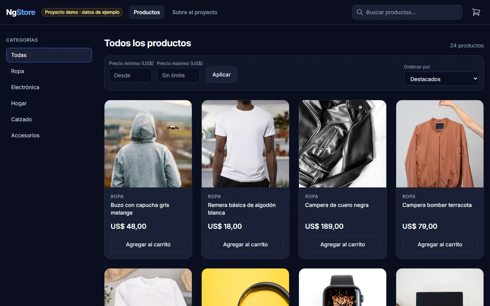
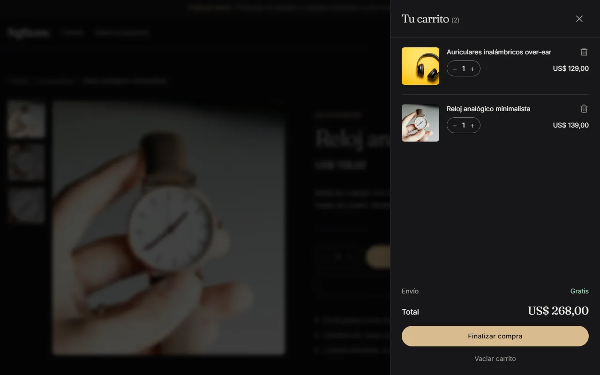
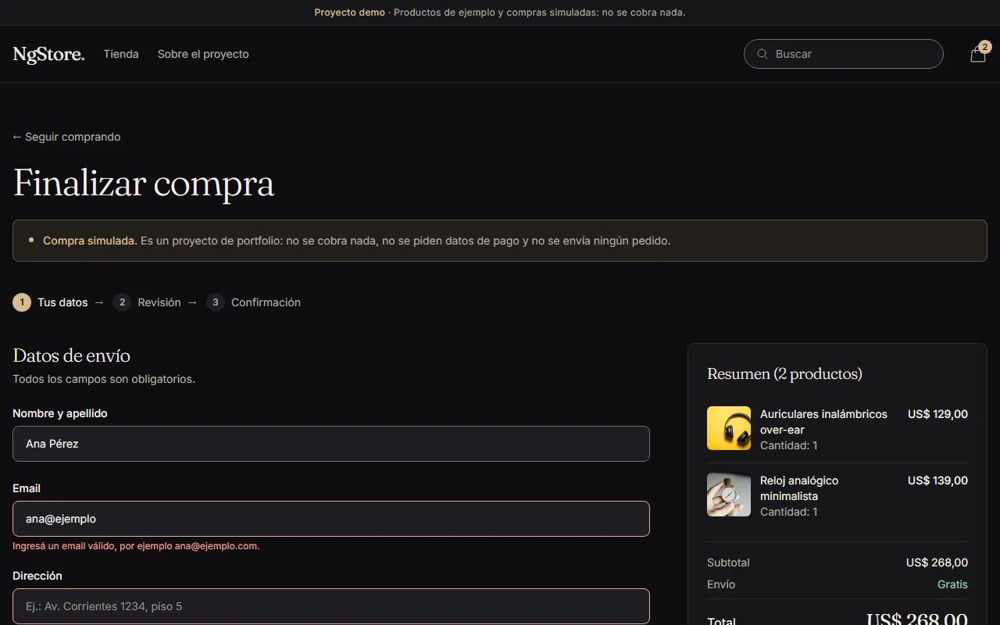
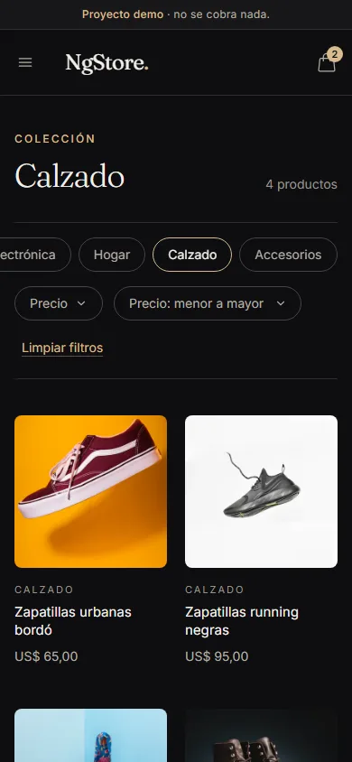

# NgStore · Tienda en línea con Angular

E-commerce completo hecho con Angular 19, signals y Tailwind CSS: catálogo con filtros, carrito persistente y checkout simulado.

**[Ver la demo →](https://tienda-en-linea-eight.vercel.app)**




> Proyecto de portfolio. Los productos son de ejemplo y las compras son simuladas: no se cobra nada.

## Funcionalidades

- **Catálogo** de 24 productos en 5 categorías, con búsqueda en tiempo real (sin distinguir mayúsculas ni acentos), rango de precio y ordenamiento.
- **Filtros en la URL**: `/category/calzado?q=zapa&sort=price-asc&max=100` se puede compartir, recargar y navegar con "atrás".
- **Detalle de producto** con galería de imágenes y selector de cantidad.
- **Carrito** en un panel lateral con cantidades, eliminación y total. Se guarda en `localStorage`.
- **Checkout simulado** en tres pasos: datos de envío con validaciones, revisión del pedido y confirmación con número de pedido.
- **Estados de carga, vacío y error** con skeletons, botón de reintentar y botón para limpiar filtros.
- **Responsive y accesible**: navegación completa con teclado, foco gestionado, labels y errores asociados a cada campo, contraste AA.

| Detalle y carrito                                                               | Checkout con validaciones                                           | Móvil                                                                     |
| ------------------------------------------------------------------------------- | ------------------------------------------------------------------- | ------------------------------------------------------------------------- |
|  |  |  |

## Stack

Angular 19 (standalone components, signals, Reactive Forms, NgOptimizedImage) · TypeScript · RxJS · Tailwind CSS · Fraunces + Inter · Jasmine + Karma · ESLint + Prettier · Vercel

## Decisiones técnicas

- **Data source intercambiable.** Los componentes dependen de la interfaz `CatalogSource` a través del InjectionToken `CATALOG_SOURCE`. Por defecto se usa un catálogo local (`LocalCatalogSource`), así la demo funciona siempre. Con `dataSource: 'api'` en `environment` se usa la [Platzi Fake Store API](https://fakeapi.platzi.com/), y si falla o tarda más de 6 s la app pasa sola al catálogo local por el resto de la sesión.
- **Estado con signals.** `signal`, `computed` y `effect` para el estado de la UI y del carrito. RxJS se usa donde aporta: peticiones, debounce del buscador y cancelación con `switchMap`.
- **Estado en la URL.** Categoría, búsqueda, orden y precio llegan a los componentes como `input()` gracias a `withComponentInputBinding`. Los valores inválidos de la URL se ignoran.
- **Latencia simulada.** El catálogo local responde con 300–600 ms de demora en filtros y navegación, para que se vean los estados de carga. La carga inicial no se demora.
- **Rendimiento.** Rutas lazy, imágenes WebP de 400 y 800 px con un loader de NgOptimizedImage (`srcset`/`sizes`) y `priority` en las imágenes visibles al entrar.
- **Diseño accesible.** Tema oscuro con acento dorado y tokens de color definidos en Tailwind: todos los textos superan 5,5:1 de contraste (WCAG AA) y los bordes de los campos, 3:1. Tipografías Fraunces (títulos) e Inter (texto), foco visible en todo, salto al contenido y respeto de `prefers-reduced-motion`.
- **Arquitectura por dominios**: `products`, `checkout`, `info` y `shared`, con alias de importación (`@products`, `@checkout`, `@shared`, `@env`).
- **SEO**: título y meta description por página, y Open Graph con imagen de preview para compartir el link.

## Cómo correrlo

Requisitos: Node.js 18.19 o superior y npm.

```bash
git clone https://github.com/barbaracortez/tienda-en-linea.git
cd tienda-en-linea
npm install
npm start
```

Abrí `http://localhost:4200/`. Para usar la API de Platzi en lugar del catálogo local, cambiá `dataSource` a `'api'` en `src/environments/`.

| Comando          | Descripción                         |
| ---------------- | ----------------------------------- |
| `npm start`      | Servidor de desarrollo              |
| `npm run build`  | Build de producción en `dist/store` |
| `npm test`       | Tests unitarios                     |
| `npm run lint`   | ESLint sobre TypeScript y templates |
| `npm run format` | Formatea el código con Prettier     |

## Tests

62 tests unitarios con Jasmine y Karma:

```bash
npm test -- --watch=false --browsers=ChromeHeadless
```

Cubren el catálogo local (filtros, búsqueda, orden, rango de precio, búsqueda por slug), el fallback de la API al catálogo local (error de servidor, error de red, timeout de 6 s), el carrito (agregar, quitar, cantidades, total, persistencia), las validaciones del checkout, el servicio de pedidos y la integridad de los datos del catálogo.

## Créditos

- Fotos de productos: [Unsplash](https://unsplash.com/) (licencia de Unsplash).
- API opcional: [Platzi Fake Store API](https://fakeapi.platzi.com/).
- Diseño y desarrollo: [Barbara Cortez](https://barbaracortez.vercel.app).
